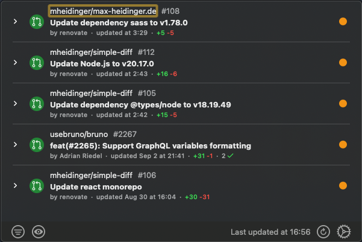
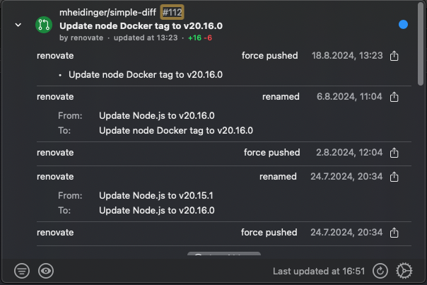

<p align="center">
 
</p>

# PReek

PReek brings a quick peek into relevant GitHub Pull Requests directly into your MacOS MenuBar!

<p align="center">
 
 
</p>

## Install

### Direct Download

A signed and notarized DMG installer can be found in the the [latest release](https://github.com/mheidinger/PReek/releases/latest).

### Brew

Brew installation is available through my personal homebrew tap:

```bash
brew install mheidinger/tap/preek
```

To make it possible for PReek to be available from the official tap, some [popularity is required](https://docs.brew.sh/Acceptable-Casks#rejected-casks). So feel free to ⭐ this repository!

## Local actions (macOS)

On an open pull request, use the editor button, agent button, or agent dropdown to prepare its Git workspace and open it in your editor or launch an agent. The agent menu includes **Address comments** for your PRs, **Review PR** for others, and saved custom prompts.

### Get started

1. Sign in to GitHub in PReek and configure Git authentication for that host.
2. In **Settings → Local actions**, choose an installed editor and a workspace folder (default `~/.preek`). The first time you use an action for a repository, select an existing local clone; PReek does not clone repositories.
3. For agent actions, install OMP and Ghostty 1.3 or newer, set the OMP executable under **Saved local agent actions**, and allow PReek to control Ghostty in **System Settings → Privacy & Security → Automation**.

If PReek finds local changes in a workspace, **Open Unchanged** keeps them; **Force Update** deletes uncommitted data. Agents can access and modify workspace files; they are not sandboxed, so review their changes.

## FAQ

### Why is the `notification` scope required for the GitHub PAT?

PReek shows Pull Requests for which you got notifications for.
To be able to fetch your notifications, the `notifications` scope is required.

### Why is a given Pull Request not shown?

As PReek shows Pull Requests for which you got notifications for, please check whether you received a notification for the missing Pull Request in the [Notifications Inbox](https://github.com/notifications).
If you did not get a notification, verify that you have not disabled them for a given repository.
See the [GitHub documentation](https://docs.github.com/en/account-and-profile/managing-subscriptions-and-notifications-on-github/setting-up-notifications/configuring-notifications) for more information.

Additionally check if the repository it private / internal and if yes, whether you granted the `repo` scope to the GitHub PAT.
This scope is required to be able to access private repositories.

### Why is no team name shown if a review has been requested by a team?

An additional PAT scope `read:org` is required to access the name of a team.

### Are there any keyboard shortcuts?

On macOS, the status bar supports **r** to refresh and **,** to open settings when the menu is focused.
